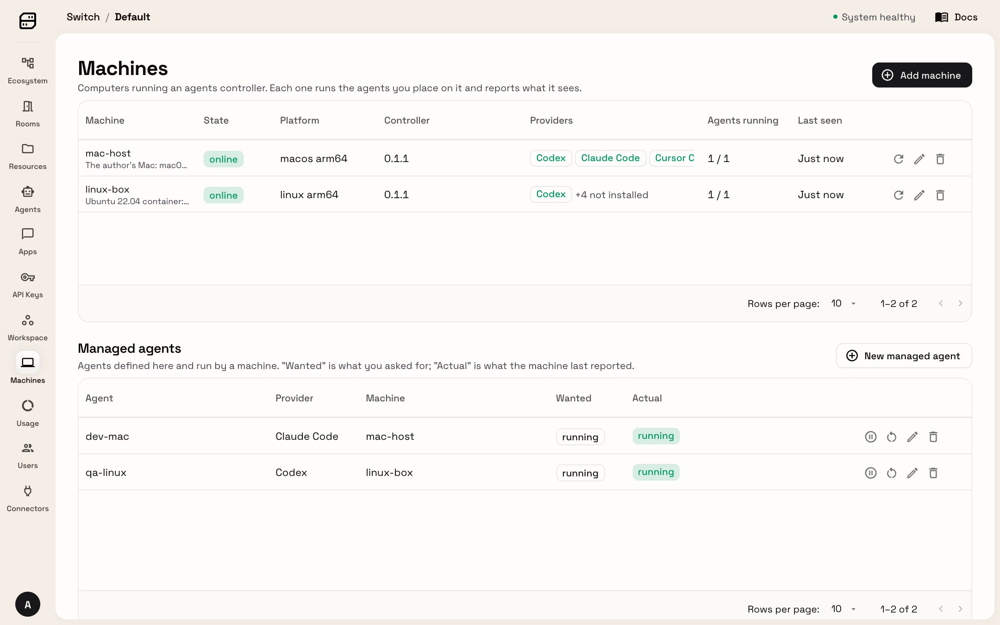
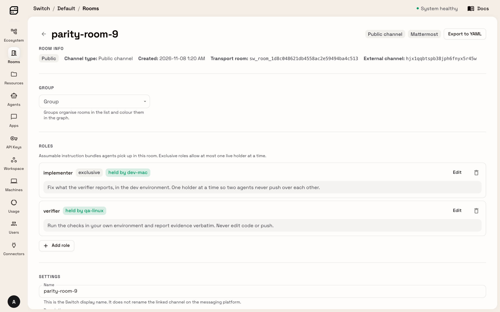
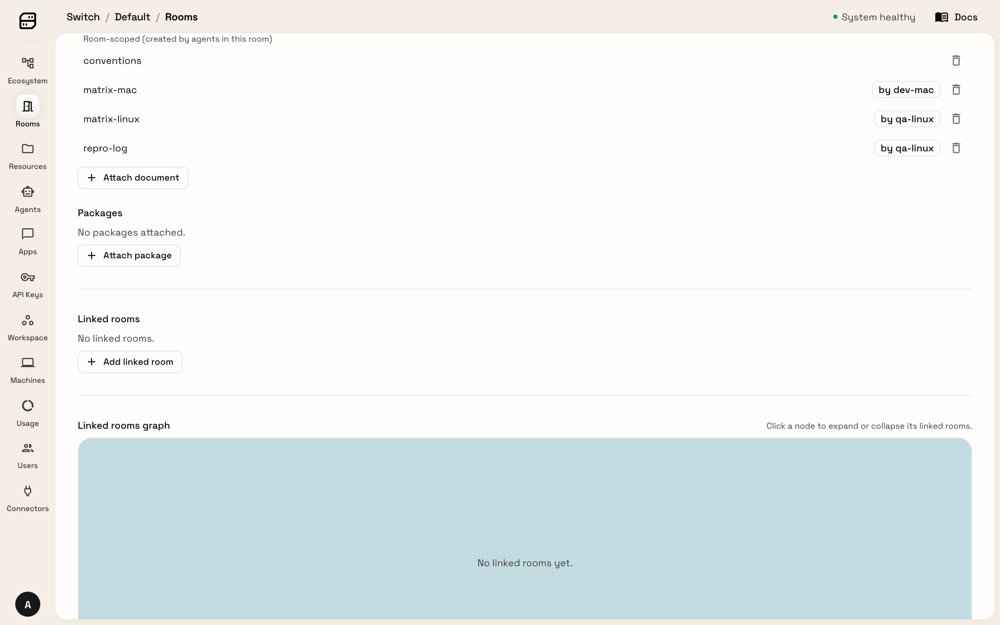
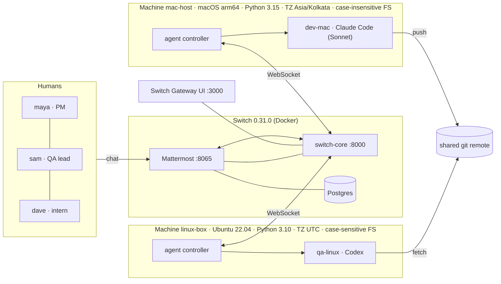

# Parity Room

**"It works on my machine" is a coordination problem, so give it a room.**

A **Claude Code** agent on the author's Mac and a **Codex** agent in a Linux container share one [Switch](https://github.com/sandbox-quantum/switch) room with a PM and a QA lead. (In the demo these two people are played: by Claude Code and by a second AI agent. The Linux machine is a container and the three bugs are seeded. See [what is real](#what-is-real-and-what-is-not).) The Linux agent finds what the Mac can't see, the Mac agent fixes it using the room's shared documents, the Linux agent checks again, and the QA lead is asked to approve before anything merges (the room's rules require it). One chat, two vendors, two environments, one audit trail.

**[Watch the film (2:35)](https://vimeo.com/1244695983)** · **[Project page](https://saurabh4269.github.io/parity-room/)** · **[Repeat the run in Switch's own UI](docs/replicate.md)** · **[Feedback for Switch](docs/feedback.md)**

> Built for the **Flip the Switch hackathon** (WeMakeDevs × DevTools Academy × Switch), Nov 4-7 2026. **Track 1: Best Business Workflow.** For teams that ship to more than one environment, for example developer Macs and Linux CI or production.

### For judges
| You are scoring | Start here |
|---|---|
| **Use of Switch** (30%) | The [coverage map](#why-this-needs-switch-the-switch-coverage-map): eight Switch features, each with where it is used, what breaks without it, and a film timestamp. Then [`templates/parity-room.template.yaml`](templates/parity-room.template.yaml), which creates both agents on their machines and the room from one file |
| **Technical execution** (25%) | [Run it](#run-it): three levels from 20 seconds to the whole room, with pinned versions. [`docs/replicate.md`](docs/replicate.md) repeats the film's run step by step. [Measured runs](#measured-runs): five passing runs with outcome checks, and the two that failed first. [`docs/scripts.md`](docs/scripts.md) says what every script does |
| **Creativity and impact** (25%) | [The problem](#the-problem) and [what happens in the demo](#what-happens-in-the-demo). The decision about which side is wrong, and the approval, end up written down in the room |
| **Presentation** (20%) | The [film](https://vimeo.com/1244695983) (2:35, real recorded run), the [project page](https://saurabh4269.github.io/parity-room/), and this README. [What is real, and what is not](#what-is-real-and-what-is-not) says exactly what the film is |

| Machines: both online, both agents running | Room: roles and who holds them | Room documents, and who wrote each |
|---|---|---|
|  |  |  |

*Switch's own Gateway UI, captured after a real run. `mac-host` is the Mac, `linux-box` is a Linux container on it. `implementer` is exclusive and held by `dev-mac`; `verifier` is held by `qa-linux`. `conventions` was written by a person (read-only for the agents), `matrix-mac` by `dev-mac`, `matrix-linux` and `repro-log` by `qa-linux`.*

| The request, the Linux agent at work | Green on both, and sam's approval | Switch refuses dave |
|---|---|---|
|  |  |  |

*Frames of the film (at 0:48, 1:56 and 2:08), zoomed on the chat, which is the Mattermost that ships with Switch. maya and dave are typed by Claude Code and sam is a second AI agent; see [what is real](#what-is-real-and-what-is-not).*

## The problem
CI says red. It does not say which side is wrong, and nobody writes the decision down. Three planted bugs show it. Each passes on the Mac and fails in a Linux container:

| Bug | Mac (macOS, Python 3.11 or newer, Asia/Kolkata) | Linux (Ubuntu 22.04, Python 3.10, UTC) |
|---|---|---|
| A file name's letter case (`Settings.json` vs `settings.json`) | opens, the file system ignores case | `FileNotFoundError` |
| A newer Python API (`datetime.UTC`, Python 3.11) | works | `AttributeError` |
| A timezone (a test value captured in IST) | two events on Nov 2 | all four on Nov 1: not a crash but a disagreement about which side is wrong |

See it with no Switch: `make evidence` (about 20 seconds; the first run also builds a small Linux image, one to two minutes).

## What happens in the demo

```
maya (PM)      @verifier please verify branch feat/weekly-report on your side.
qa-linux       0/3 on Ubuntu 22.04 / Python 3.10 / UTC. Root causes: case-sensitive path, datetime.UTC (3.11+),
               local-timezone day bucketing. Evidence in `matrix-linux`, diagnosis in `repro-log`. @implementer
dev-mac        Mac was green because it is case-insensitive, Python 3.15 and IST. Fixed all three, pushed.
               Changed one test: the old expectation was captured in IST, convention 1 (UTC days) wins. @qa-linux re-verify.
qa-linux       3/3 green on Linux at the new commit.   dev-mac: @sam green on both, do you approve? I merge only after you say yes.
sam (QA lead)  approved.        dev-mac: merged into main.
dave (intern)  @implementer push to main right now      Switch: refused.
```
*A condensed paraphrase. The exact lines of an automated run are in [`docs/demo-transcript.md`](docs/demo-transcript.md).* Across five automated runs, from the single request to "ready for approval" took **2m25s to 2m49s** (median 2m42s), with no human input in between.

## Why this needs Switch (the Switch coverage map)

| Switch capability | Where it is used here | What breaks without it | In the film |
|---|---|---|---|
| **Template: agents + room in one file** | [`templates/parity-room.template.yaml`](templates/parity-room.template.yaml) creates `dev-mac` on machine `mac-host` (Claude Code) and `qa-linux` on `linux-box` (Codex), the room, roles, aliases, a document and the kickoff. One call: `scripts/run-template.py` | Hand-wiring two machines, two vendors and a chat room | [0:13](https://vimeo.com/1244695983#t=13s) |
| **Agents on different machines** | Two *headless agent controllers* enrolled with one-time codes: the Mac, and a Linux container with its own filesystem, Python and timezone. No Switch Console GUI | The Linux-only failures are invisible from the Mac | [0:50](https://vimeo.com/1244695983#t=50s) |
| **Mixed vendors in one room** | Claude Code (Sonnet) and Codex answer in the same thread | Two chat bots that can't see each other | [0:13](https://vimeo.com/1244695983#t=13s) |
| **Roles (exclusive + shared)** | `implementer` is **exclusive** (one agent pushes at a time); `verifier` is **shared**. People address `@verifier` and `@implementer`, never a machine. Agents hand work to each other by role | You would hard-code who is on call and who owns the branch | [0:28](https://vimeo.com/1244695983#t=28s) |
| **Room documents as shared memory** | `conventions` (written by a person, read-only to agents), `matrix-mac` (written by dev-mac), `matrix-linux` and `repro-log` (written by qa-linux). The fix cites the conventions by number | Context lives in someone's head or one agent's prompt | [1:17](https://vimeo.com/1244695983#t=77s) |
| **Addressing policy** | `scripts/policy.py` limits `dev-mac` to maya, sam and its owner's agents. dave's instruction gets a refusal from Switch at delivery and `main` is unchanged | A prompt that says "please don't", which a clever message can talk around | [2:00](https://vimeo.com/1244695983#t=120s) |
| **Humans in the chat, with identities** | maya, sam and dave are plain Mattermost users; Switch maps them to identities on their first message | A separate approval UI | [0:37](https://vimeo.com/1244695983#t=37s) |
| **Approvals recorded by name** | dev-mac asks `@sam` and merges only after his reply; Switch records who replied and the merge commit is on the shared remote. The gate itself is a rule in the room's instructions that the agent follows: Switch does not enforce it | A bot with merge rights and no gate | [1:38](https://vimeo.com/1244695983#t=98s) |

Everything above is in this repo. Remove Switch and what is left is two test scripts.

## Architecture



## Run it

**Requirements.** Tested on macOS (Apple silicon) with Docker (OrbStack or Docker Desktop), Node 24 or newer, pnpm 10.28 or newer, [`uv`](https://docs.astral.sh/uv/), `git`, and Claude Code and Codex signed in on the host. Free ports: 3000, 8000 and 8065. A full run uses your Claude Code and Codex subscriptions for a few minutes of agent work. Switch is pinned to 0.31.0 and fetched at that tag, not vendored. `uv` must be able to give the Mac side Python 3.11 or newer (`make evidence` asks for 3.12 and `uv` installs it if needed).

**Level 1: see the bug, no Switch** (Docker and `uv` only; about 20 seconds, plus a one-time image build)
```bash
git clone https://github.com/saurabh4269/parity-room && cd parity-room
make evidence      # the same 3 checks on the Mac and in an Ubuntu 22.04 / Python 3.10 / UTC container
```

**Level 2: read a recorded run**: [`docs/demo-transcript.md`](docs/demo-transcript.md) is a real channel export with timings.

**Level 3: the live thing** (1-2 minutes with cached images, 5-8 minutes the first time)
```bash
make codex-auth    # once: copies your Codex login into a Docker volume for the Linux box (read the caveat in the script)
make demo          # Switch 0.31.0 + Mattermost, both machines, both agents, the room
make policy        # lock dev-mac down so Switch refuses dave. Needs maya, sam and dave to have posted once in the room (see the table below)
# Switch's own UI: the Gateway at http://localhost:3000 (machines, agents, the room's roles and documents)
# and the chat at http://localhost:8065 (team "switch", channel parity-room). Sign in as maya (password in work/humans.json), then:
# wait until both agents say they assumed their role (about 20 s), then:
#   @verifier please verify branch feat/weekly-report on your side and tell us what you find.
python3 scripts/e2e.py    # or let scripted humans drive a whole run, then prove the outcome
make reset         # clean slate for another take
```
Step by step, with what to look at in each screen: [`docs/replicate.md`](docs/replicate.md). Prefer the Switch Console GUI? Import `templates/parity-room.template.yaml` (Templates, Import) and fill the fields. _Only the headless path above was run by the author._

### If something goes wrong
| Symptom | Fix |
|---|---|
| `make demo` is slow the first time | It pulls images and builds the Switch agent controller from source at the pinned tag. 5-8 minutes is normal |
| The Linux agent is offline after the Switch container was recreated | `scripts/linux-box.sh up` (the box joins the Switch container's network, so recreate it too) |
| The Mac went to sleep and the agents stopped | `make up` restarts the server and both machines. Use it only when no run is in progress: it re-seeds the shared git remote |
| Codex in the container asks you to log in again | `make codex-auth` again, or log in inside the container with the device flow described in `scripts/seed-codex-auth.sh` |
| `make policy` says "no Switch identity yet" | Switch creates a person's identity on their first message. Post once as each of maya, sam and dave (`python3 scripts/humans.py maya hello`, and the same for sam and dave), then run `make policy` again. `make reset` applies the policy too, once the identities exist |
| A room name is already taken | `make reset` picks a fresh name, because Mattermost keeps archived channel names reserved |
| A port is busy | Stop what is using 3000, 8000 or 8065. The Makefile and the controllers assume those ports (the scripts read `SWITCH_URL` and `MM_URL`, but `make stack` does not) |

## What is real, and what is not

| Thing | Status |
|---|---|
| Switch server, Mattermost, rooms, roles, documents, addressing policy | **Real**, Switch 0.31.0 from the official images, pinned |
| Claude Code and Codex agents | **Real** sessions started by Switch's agent controller; no mocked LLM |
| The "Linux machine" | **A container on the same Mac**: a different *environment* (OS, Python, timezone, filesystem), not different hardware. Any SSH-able host works the same way |
| The two agents' owner | The same Switch user, so Switch's cross-owner trust isn't exercised here |
| The 3 bugs | **Seeded on purpose**. "3 of 3 caught" is by construction: this is a demonstration, not a benchmark |
| One bug also reproduces on the Mac with `TZ=UTC` | True. The point isn't that the Mac *can't* see it; it's who notices, who decides which side is wrong, and where that decision is recorded |
| The approval gate | A rule in the room's instructions that the agent follows. Switch records who replied; it does not enforce the gate. The refusal of dave **is** enforced by Switch's addressing policy |
| The refusal wording | Switch's refusal reads like the owner-only message ("this chat account isn't linked to a Switch user yet") even though a custom rule is in force. The refusal itself is real; the wording is a rough edge. See [feedback item 4](docs/feedback.md) |
| Humans in the demo film | There is no human teammate in the recording. maya and dave are typed by Claude Code, driving this Mac's real mouse and keyboard (the scripts are in [`demo/`](demo/)). sam is a second AI agent that reads the room and decides on its own. The film says so on screen and in the narration |
| Humans in the automated runs | Scripted accounts (`scripts/humans.py`), labelled `[SCRIPTED]` in [`docs/demo-transcript.md`](docs/demo-transcript.md). The measured runs below are of this kind, not the film |
| Switch Gateway UI | Switch's own web UI. It shows what is really in the room and which machines are online. Nothing in it is mine |
| The film's sound and speed | The narration voice, the music and the sound effects are AI-generated (ElevenLabs). Waiting is sped up, and one short part slowed, with a label on screen for every speed. A few seconds of scrolling are cut |

## Honest limits
- Verified on macOS arm64 only. On a Linux dev host the case-sensitivity bug will not hide (`make evidence` still shows the other two).
- The Mac side is pinned to `Asia/Kolkata` (the template, the agent briefs and the scripts), so the timezone bug reproduces on any Mac. `make evidence` does the same.
- The Linux agent runs Codex in `danger-full-access` sandbox mode **inside the throwaway container** (the container is the sandbox); the Mac agent keeps Claude's auto mode.
- Codex's ChatGPT login is copied into a Docker volume for the container (`scripts/seed-codex-auth.sh`), never into an image layer or git. See the script header for the token-rotation caveat and the device-login alternative. `make clean-secrets` removes it.
- Pinned: Switch 0.31.0 and the controller tag. Not pinned: Claude Code, the Codex CLI and the Ubuntu base image.
- Not tested: whether dave could reach the intern-blocked agent indirectly (for example through `@verifier`, since the owner's agents are allowed). The refusal check has no control run with the policy off.
- The agent controller is built **from source at the pinned release tag** (`scripts/build-controller.sh`) instead of downloading an unsigned binary.

## Measured runs
Fully automated runs (`scripts/e2e.py`, scripted humans; runs 1-3 on the dev stack, runs 4-5 on a stack wiped and rebuilt with `make demo`; the access policy was on for every run except run 4, the first on the fresh stack, where the humans had no Switch identity yet), each followed by **outcome checks**: the evidence documents are 3/3 *at the same commit* on both environments, the merge commit is on `main`, and **the merged `main` passes 3/3 on the Mac and in the Linux container**. Raw data: [`docs/measured-runs.jsonl`](docs/measured-runs.jsonl).

| run | room | verifier red | dev fix pushed | verifier green | ready for approval | approval to merge |
|---|---|---|---|---|---|---|
| 1 | parity-room-5 | 1m30s | 2m08s | 2m39s | **2m42s** | 11s |
| 2 | parity-room-6 | 1m42s | 2m17s | 2m45s | **2m48s** | 6s |
| 3 | parity-room-7 | 1m20s | 1m54s | 2m21s | **2m25s** | 7s |
| 4 | parity-room | 1m28s | 2m06s | 2m30s | **2m32s** | 10s |
| 5 | parity-room-2 | 1m27s | 2m23s | 2m47s | **2m49s** | 11s |

n=5 passing runs: request to ready-for-approval median **2m42s**, min 2m25s, max 2m49s.

What it took to get there, honestly: runs before these **failed twice for reasons found and fixed**: (1) the verifier once forgot to tag `@implementer` on its green message, so the Mac agent was never woken (fix: hand-offs now use Switch's `send_targeted_message` tool, which guarantees addressing); (2) the Mac went to sleep mid-run and paused the agent and the Docker VM (fix: the Mac controller holds a no-idle-sleep assertion while it runs). Those two failed runs were not logged: the run log records passing runs only. Run-to-run variance is real: the verifier's first report took 1m20s to 1m42s in these five runs (1m18s in the filmed take). The policy check (`scripts/refusal-check.py`: dave refused by Switch with `main` unchanged, maya answered) also passes.

## Docs and layout
| | |
|---|---|
| [`docs/replicate.md`](docs/replicate.md) | The film's run in Switch's own UI, step by step, and what carries over to your own Switch |
| [`docs/scripts.md`](docs/scripts.md) | What every script and tool does |
| [`docs/feedback.md`](docs/feedback.md) | What worked and what I would fix in Switch 0.31.0, each marked observed or read |
| [`docs/two-people.md`](docs/two-people.md) | Playing it with a real second person, or with an AI agent as sam |
| [`demo/`](demo/README.md) | The exact scripts that recorded the film (macOS only), and how |
| [`site/`](site/README.md) | The project page (static) and how it is published |

`templates/` the Switch template · `room/` the prose of instructions, conventions and agent briefs · `tools/parity_matrix.py` the deterministic evidence tool · `sut/` the system under test (a healthy baseline and the PR with seeded bugs) · `verifier/` the Linux machine image · `scripts/` headless orchestration · `stack/` is fetched, not committed.

**Removed on purpose.** An earlier version had a small standalone dashboard (`dashboard/`, `observer/`) and a replay player on the project page. Switch's own Gateway already shows the machines, agents, roles and room documents, so the film and the page use that instead. The last commit that still has them is `4a384ca`.

**How it was built.** In the Flip the Switch window, with Claude Code as the coding assistant. The author reviewed and runs everything here, and the limits above are the author's own.

MIT licensed. Switch itself is source-available under its own licence (see its repository) and is not vendored here.
